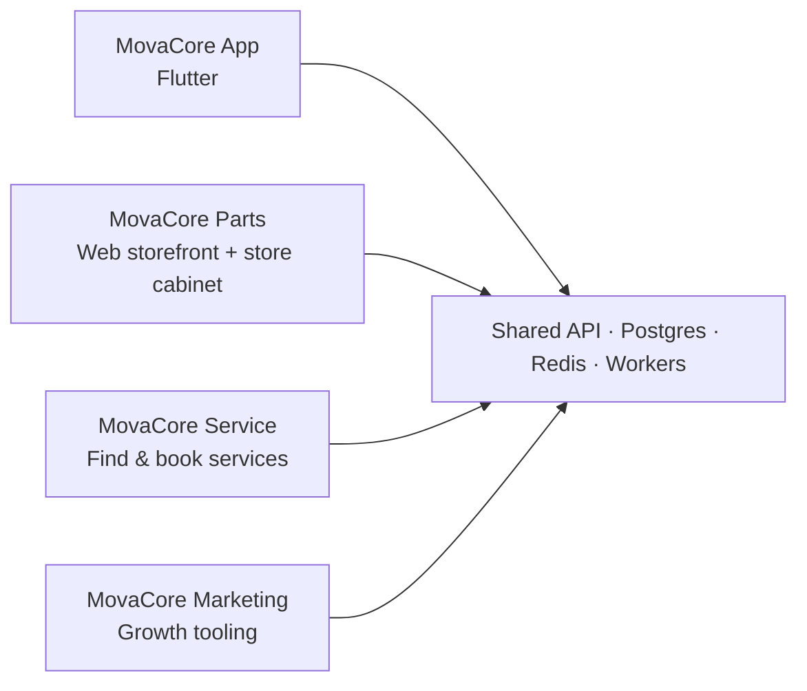
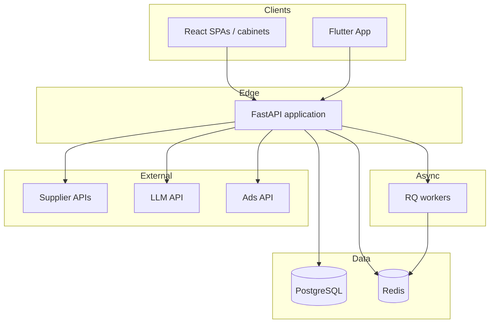
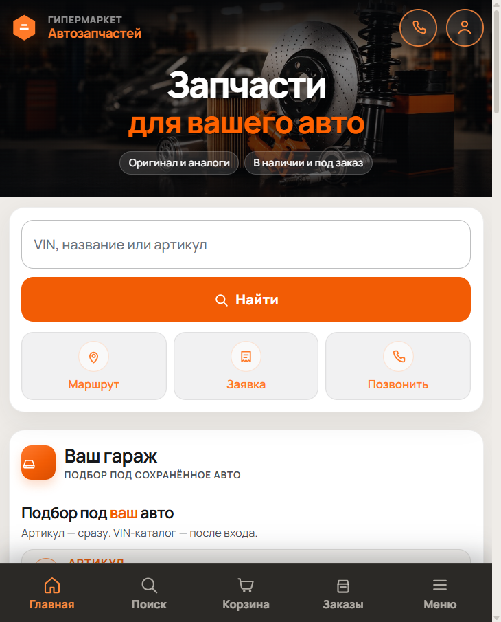
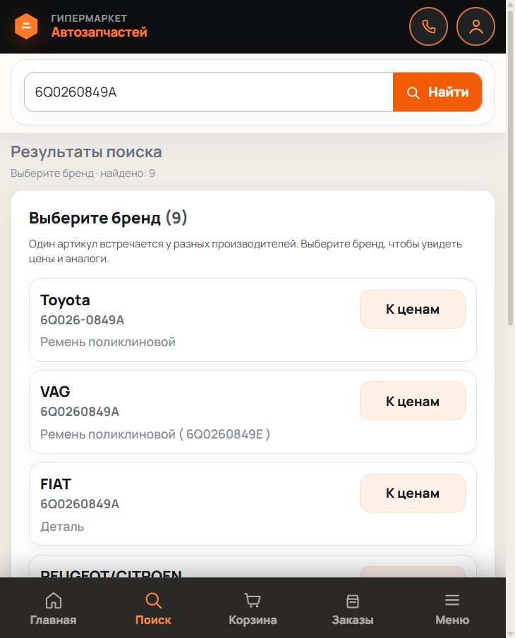
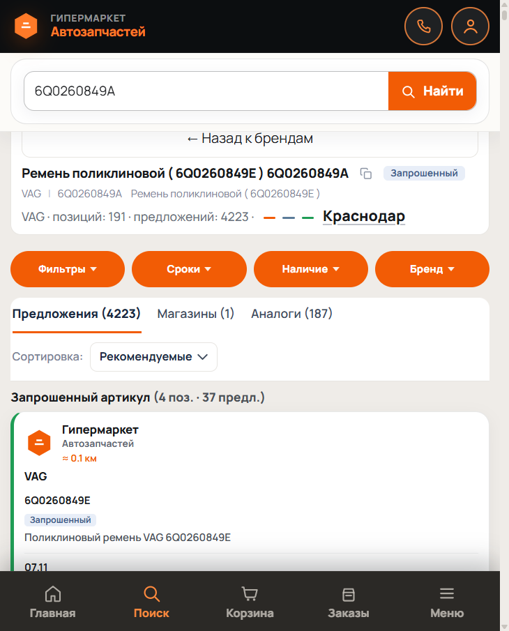
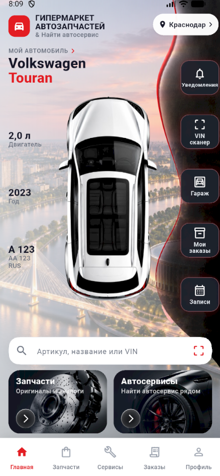
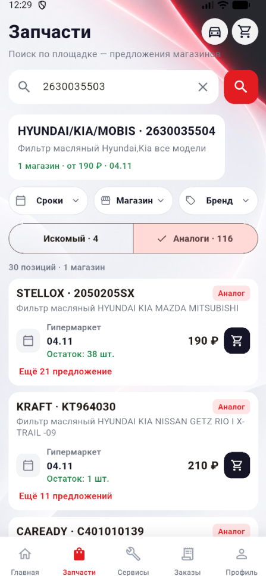
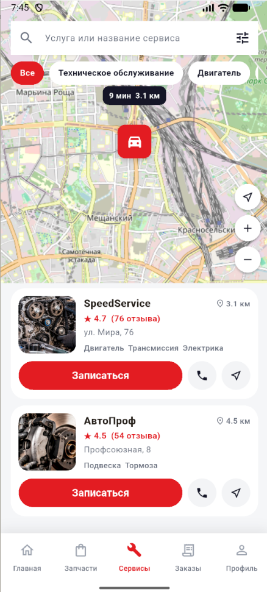

# MovaCore

**An Integrated Digital Ecosystem for the Automotive Industry**

Building connected digital products for automotive businesses and vehicle owners.

---

## Overview

MovaCore is a multi-product digital platform for the automotive domain. It connects **vehicle owners**, **auto parts retailers**, and **auto service businesses** through shared backend services, web cabinets, and a mobile companion app.

The platform is built and operated as a real production system: API backends, PostgreSQL persistence, Redis caching and queues, Docker-based deployment on a VPS, and Applied AI tooling where it creates measurable operational value.

This repository is a **public engineering portfolio**. It documents architecture, design decisions, and safe demonstration code. It is **not** a mirror of the private production codebase.

---

## Problem

Automotive businesses and car owners still operate across fragmented tools:

- Parts search is split across supplier portals and spreadsheets.
- Service booking, garage records, and parts orders live in separate apps.
- Marketing operations (ads, CRM-adjacent workflows) rarely connect to inventory or service demand.
- AI features are often demos, not production workflows with validation and human approval.

MovaCore addresses this by building one ecosystem with clear product surfaces and shared infrastructure.

---

## Who It Is For

| Audience | Value |
|---|---|
| Vehicle owners | Garage, VIN-based parts discovery, service search, bookings, notes |
| Parts retailers / store operators | Store cabinet, supplier API sourcing, pricing, orders and leads |
| Auto services | Service cabinet, clients, booking posts, operational workflows |
| Platform operator | Multi-tenant hub, product subscriptions, infrastructure control |

---

## Platform Directions

### MovaCore Parts
Hypermarket-style parts discovery: article/VIN-oriented search, multi-supplier offers, store cabinets for connected shops, pricing rules, and order/lead flows.

Public storefront: [гипермаркет-автозапчастей.рф](https://гипермаркет-автозапчастей.рф/)

### MovaCore Service
Service discovery and booking for vehicle owners, plus operator cabinets for workshops (clients, posts, appointments). Primary customer UX also surfaces in the Flutter companion app.

### MovaCore Marketing
Business promotion tooling for automotive SMBs, including Applied AI workflows for advertising operations (structured plans, tool calling, human-in-the-loop apply).

Public marketing site: [movacore.ru](https://movacore.ru/)

### MovaCore App — Automotive Companion

A mobile application designed to connect vehicle owners with automotive services, spare parts, maintenance records, and intelligent digital tools.

The goal is to create a unified digital experience for managing vehicle ownership.

See [docs/mobile-app.md](docs/mobile-app.md).

Honest product UI status: [docs/product-audit-stage3.md](docs/product-audit-stage3.md).

---

## Tech Stack (audit-confirmed)

| Layer | Technologies |
|---|---|
| Backend | Python, FastAPI, Uvicorn |
| Frontend (web) | React, TypeScript, Vite, React Query |
| Mobile | Flutter (Dart) |
| Data | PostgreSQL 16 |
| Cache / queues | Redis, RQ workers |
| AI | OpenAI-compatible LLM API (via OpenRouter-style gateway), structured JSON, tool/function calling |
| Integrations | Automotive supplier APIs (e.g. Rossko, Berg), advertising APIs (Yandex Direct) |
| Infrastructure | Docker Compose, VPS deployment |

Only technologies confirmed by a read-only audit of the private projects (or present as safe demos in this repo) are listed above.

---

## Architecture at a Glance

Detailed diagrams: [architecture/](architecture/) · narrative docs: [docs/architecture.md](docs/architecture.md).

---

## Engineering Highlights

- **Multi-product hub** with shared auth, persistence, and product-scoped cabinets
- **Supplier API sourcing** for parts availability (API-first, not spreadsheet uploads as the primary path)
- **Store and service operator cabinets** with navigation-driven module structure
- **Cache-aware shop search** with Redis, including correctness guards around OEM → analog expansion
- **Applied AI agent pattern** for advertising: analyze → structured plan → dry-run / policy gate → human apply
- **Mobile companion** sharing the same backend domain as Parts and Service

Safer, rewritten examples live under [examples/](examples/) — they illustrate patterns without copying private business logic.

---

## Applied AI Direction

Production-oriented AI work in MovaCore focuses on **tool-using agents with structured outputs and human approval**, not unconstrained chat.

| Capability | Status |
|---|---|
| LLM API integration (OpenAI-compatible) | Implemented in private product (Marketing / Direct agent path) |
| Structured JSON responses | Implemented |
| Tool / function calling over domain APIs | Implemented (gated action set) |
| Human-in-the-loop apply | Implemented |
| Policy / allowlist gating of agent actions | Implemented |
| Retries, timeouts, observability | Partial / evolving |
| RAG over private corpora | Not claimed as production; demos may illustrate the idea |
| Full autonomous multi-agent ops | Planned / experimental |

See [docs/ai-integration.md](docs/ai-integration.md) and [examples/ai/](examples/ai/).

---

## Infrastructure

- Application and dependencies packaged with **Docker Compose**
- Deployed and operated on a **VPS** (details intentionally omitted from this public repo)
- Redis for cache and job queues; PostgreSQL for durable state
- Separate concern lines: platform owner cabinet vs per-store / per-service cabinets

See [docs/infrastructure.md](docs/infrastructure.md) and [docs/deployment.md](docs/deployment.md).

---

## Engineering Case Studies

Real technical cases from the audited private systems (no invented metrics):

→ [docs/case-studies.md](docs/case-studies.md)

## Live Demo & AI Demo

| Doc | Purpose |
|---|---|
| [docs/live-demo.md](docs/live-demo.md) | What is publicly browsable vs local-only vs closed |
| [docs/ai-demo.md](docs/ai-demo.md) | Production ads-agent pattern + automotive assistant teaching demo |
| [docs/engineering-interview.md](docs/engineering-interview.md) | Interview questions grounded in MovaCore |
| [architecture/](architecture/) | System diagrams (Mermaid) |

## Screenshots

Real captures only (no fabricated UI). Full index: [`assets/screenshots/`](assets/screenshots/) · inventory: [`docs/full-product-screen-audit.md`](docs/full-product-screen-audit.md).

### Parts (public storefront)

| Home | Search | Results | Offers |
|---|---|---|---|
|  |  |  |  |

### MovaCore App (Flutter)

| Home | Parts | Services | Profile |
|---|---|---|---|
|  |  |  |  |

### Marketing (public site)

| Landing | Products |
|---|---|
|  |  |

Authenticated cabinet interiors (store / service / marketing / platform admin) are **not** shown — login surfaces only. Remaining shot list: [`assets/screenshots/SHOT_LIST.md`](assets/screenshots/SHOT_LIST.md).

---

## Development Status

| Area | Status |
|---|---|
| Shared FastAPI backend | Active / production |
| MovaCore Parts (web + store cabinet) | Active / evolving |
| MovaCore Service (web + service cabinet) | Active / evolving |
| MovaCore Marketing | Active / AI workflows evolving |
| MovaCore App (Flutter) | Active / feature set expanding |
| Public portfolio documentation (this repo) | In progress |

Honest feature status for the mobile app: [docs/mobile-app.md](docs/mobile-app.md).

---

## Roadmap (high level)

- Deepen Applied AI evaluation, observability, and safer tool policies
- Strengthen Parts ↔ Service ↔ App continuity (garage, orders, bookings)
- Improve operator analytics without exposing private metrics publicly
- Expand public demos and architecture artifacts in this portfolio repo

Full notes: [docs/roadmap.md](docs/roadmap.md).

---

## Repository Contents

| Path | Purpose |
|---|---|
| `docs/` | Technical documentation, About, case studies |
| `architecture/` | Mermaid system diagrams |
| `examples/` | Safe Python / API / AI demos + run guide |
| `assets/` | Diagrams, logos, screenshot shot list |
| `.github/` | Issue templates and CI for demos |

---

## About the Builder

Entrepreneur and software product builder with a programming background, currently deepening Python engineering skills.

Hands-on experience running a real automotive business while designing, building, and maintaining digital products — APIs, databases, backend systems, web cabinets, a Flutter companion app, and Applied AI tooling aimed at production workflows.

Interested in Applied AI and production-ready AI applications: structured outputs, tool calling, validation, human-in-the-loop control, and systems that survive real operational constraints.

This portfolio reflects work done while independently designing and evolving a complex product ecosystem — not a claim of senior/lead titles or research credentials.

**Full page:** [docs/about-the-builder.md](docs/about-the-builder.md)

---

## Security & Privacy

- Private production source, secrets, customer data, and infrastructure internals stay private.
- This repository contains documentation and **rewritten** examples only.
- See [SECURITY.md](SECURITY.md) and [PUBLICATION_CHECKLIST.md](PUBLICATION_CHECKLIST.md).

## License

Documentation and demonstration code in this repository are released under the [MIT License](LICENSE).  
The private MovaCore production codebase is **not** licensed by this file.

## Contributing

This is primarily a portfolio / documentation repository. See [CONTRIBUTING.md](CONTRIBUTING.md).
