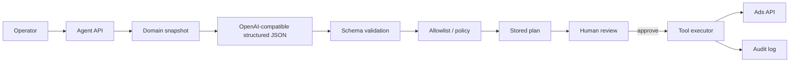

# AI Demo — Applied AI in MovaCore

## Important honesty

The **production** Applied AI path confirmed by audit is the **Marketing / advertising operations agent**: structured JSON plans, allowlisted tools, human-in-the-loop apply.

An **“AI Automotive Assistant”** that diagnoses car problems for end users is a **preferred portfolio scenario**. It is **not** claimed as a shipped mobile feature.  
This document describes:

1. The real production pattern (ads agent).  
2. A **safe teaching demo** that mirrors the same engineering pattern for an automotive assistant (`examples/ai/automotive_assistant.py`).

---

## 1. Production pattern (Marketing ads agent)

### Architecture



### Sequence

1. Build business/context snapshot (KPIs, campaigns context — sanitized for the model).  
2. Call LLM with structured JSON expectation.  
3. Validate plan schema (Pydantic / JSON schema).  
4. Drop non-allowlisted actions.  
5. Persist plan; operator reviews.  
6. On approve, execute tools; append audit.  

### Model / gateway

- **Confirmed:** OpenAI-compatible chat API via a gateway (OpenRouter-style configuration in private ops).  
- Exact production model ID is **not** published here (may change; avoid lock-in claims).

### Tool calling

Fixed allowlist examples (abstracted): change bid, add negative keyword, pause/enable keyword/ad/campaign — gated by policy.

### Structured outputs

Plans are JSON objects with typed actions + rationale — not free-form executable scripts.

### Validation & errors

- Invalid schema → safe error, no side effects.  
- Timeouts/retries on LLM HTTP client (partial/evolving observability).  

### Safety

- API keys server-side only.  
- Human apply for side effects.  
- Sanitize plans before UI.  
- No autonomous unlimited spend changes by design.

### Limitations

- Evaluation harness and cost/quality dashboards are **partial**.  
- Not a general conversational car mechanic in production.

---

## 2. Portfolio demo — AI Automotive Assistant (teaching)

Path: `examples/ai/automotive_assistant.py` + tests.

### Intended user flow (demo)

1. User describes a vehicle symptom in natural language.  
2. Assistant (LLM or Echo stub) returns **structured JSON**: likely systems, suggested checks, optional tool requests.  
3. Allowed tools are limited (e.g. `search_parts_by_article`, `suggest_service_category`) — demo stubs.  
4. Validator rejects unknown tools / malformed payloads.  
5. Any “create booking / place order” style action is marked **`requires_human_confirmation: true`** and is **not** auto-executed.

### Run

```bash
pytest examples/ai -q
```

Offline by default (`EchoLLMClient` / deterministic fixtures).

### What this proves for Applied AI interviews

- Structured outputs  
- Tool allowlists  
- Validation  
- Human-in-the-loop for irreversible actions  
- Separation of “advice” vs “side effects”  

### What this does not prove

- Clinical diagnostic accuracy  
- Production mobile assistant GA  
- Live supplier or booking mutation without humans  

---

## Related

- [AI Integration](ai-integration.md)  
- [Case Studies](case-studies.md) (Case 3 — ads agent)  
- `examples/ai/`  
