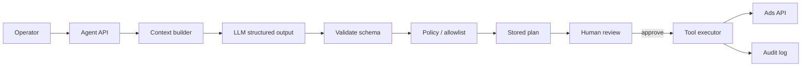

# AI Integration Architecture

## Positioning

MovaCore’s Applied AI work targets **production operational workflows**, especially marketing/ads assistance: the model proposes structured actions; the system validates, gates, and requires human confirmation before side effects.

This is closer to **AI engineering** (tools, schemas, policies, audit) than to unconstrained chatbots.

## Confirmed Production Pattern (private product)

**Yandex Direct–oriented agent path** (names abstracted in public docs):

1. Build a business/context snapshot for the agent  
2. Call an OpenAI-compatible chat API requesting **structured JSON**  
3. Parse and validate a plan of allowlisted actions  
4. Apply **policy gates** (what the agent may propose / execute)  
5. Support **dry-run** and **human apply**  
6. Persist plans and append audit records  

## Capability Matrix

| Topic | Status |
|---|---|
| LLM API integration | **Implemented** (OpenAI-compatible gateway) |
| Structured outputs | **Implemented** |
| Tool / function calling | **Implemented** (fixed allowlist) |
| AI agents (single-domain) | **Implemented** for ads ops path |
| Human-in-the-loop | **Implemented** |
| Evaluation harness | **Partial / evolving** |
| Retries & timeouts | **Partial / evolving** |
| Observability (traces, cost, quality) | **Partial / evolving** |
| RAG over private docs | **Not claimed as production**; optional demo experiment only |
| Mobile AI assistant | **Planned / experimental ideas** — see mobile-app.md |
| Fully autonomous spend changes | **Not** the design goal; gates + HITL preferred |

## Safety Principles

- No API keys in clients or public repos  
- Allowlisted actions only  
- Sanitize plans before returning to UI  
- Prefer structured schemas over free text for executable steps  
- Log audits without storing secrets  

## Demo Code

`examples/ai/` contains rewritten teaching implementations:

- Abstract `LLMClient` interface  
- Structured response models (Pydantic)  
- Tool registry + executor  
- Retry/timeout sketch  
- Simple evaluation checklist  

These demos **do not** call production endpoints and use environment placeholders only.
