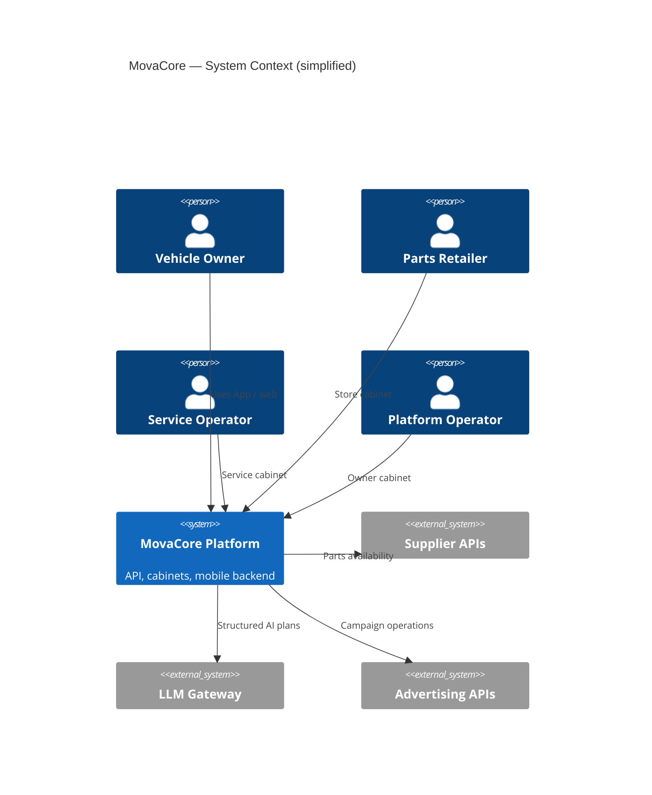

# System Architecture

## Context

MovaCore is a multi-surface product: React web applications (storefronts and operator cabinets), a Flutter mobile app, and a FastAPI backend with PostgreSQL and Redis.

> If a renderer does not support C4, see equivalent flowcharts in `/architecture/*.mmd`.

## Logical Containers

| Container | Role |
|---|---|
| FastAPI app | HTTP API, auth sessions, product routes, cabinets |
| React SPAs | Storefront UI, store cabinet, service cabinet, platform cabinet |
| Flutter app | Owner-facing companion (garage, parts, services, bookings) |
| PostgreSQL | Durable entities (users, shops, bookings, products, etc.) |
| Redis | Cache + RQ job broker |
| Workers | Background jobs (queue consumers) |

## Request Path (typical)

1. Client (web or mobile) calls HTTPS API routes on the FastAPI app.
2. Auth middleware resolves session / token context.
3. Handlers read/write PostgreSQL; hot paths may use Redis cache.
4. External supplier or ads calls happen server-side with secrets never sent to clients.
5. Long-running or deferred work is enqueued to Redis/RQ workers.

## Error Handling Patterns

- Structured JSON error responses from API handlers
- Timeouts on external HTTP clients (supplier / LLM / ads)
- Cache invalidation / drop guards where incorrect cache would hide required data (e.g. OEM analogs)
- AI path: validate structured output → policy gate → human apply (no silent side effects for sensitive actions)

## What Is Intentionally Abstracted

Public docs omit concrete VPS addresses, internal container names tied to production secrets, and private route inventories that would aid abuse. Patterns remain accurate at the container level.
