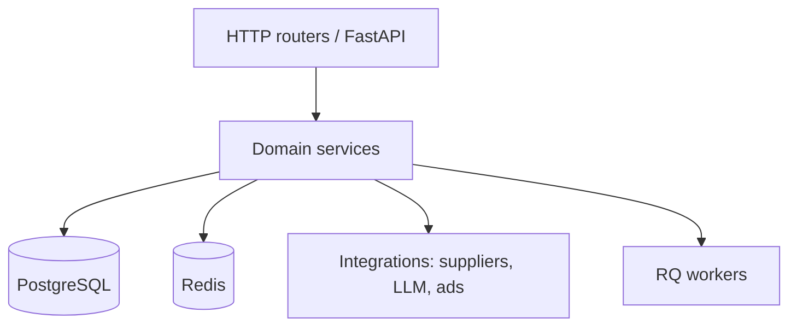

# Backend Architecture

## Stack

- **Language:** Python  
- **Framework:** FastAPI  
- **Server:** Uvicorn  
- **Persistence:** PostgreSQL  
- **Cache / broker:** Redis  
- **Jobs:** RQ workers  

## Responsibilities

The backend is the system of record for:

- Authentication and session handling for web and mobile clients
- Parts search orchestration across supplier APIs
- Store and service cabinet APIs
- Booking and related service workflows
- Product / subscription surfaces for the platform hub
- Applied AI agent endpoints (structured plans, tool execution under policy)

## Layering (conceptual)

## Notable Engineering Patterns (audit-confirmed)

- Modular panel/domain packages rather than a single monolithic script for all product logic
- Server-side aggregation of supplier responses for storefront search
- Explicit analog/OEM merge rules with cache correctness guards
- AI agent with allowlisted actions, plan storage, and human apply — not free-form autonomous writes

## Demonstration Code

Safe illustrations of FastAPI patterns (validation, errors, typing) live in `examples/python/` and `examples/api/`. They are rewritten for teaching and do not copy private handlers.
