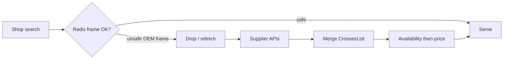
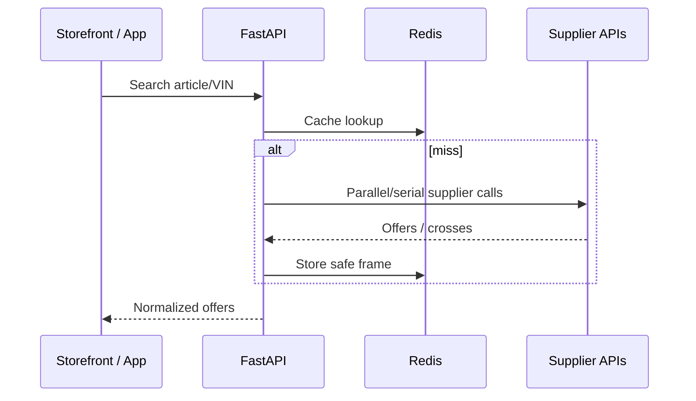

# Engineering Case Studies

Real technical cases drawn from the audited MovaCore private systems.  
No invented KPIs, latency numbers, or revenue claims.

---

## Case 1 — OEM → Analogs Without Lying Cache

### Problem
For OEM brand searches (e.g. VAG article), the storefront must show supplier crosses/analogs (e.g. Gates). A cache frame that said “primary resolved” while missing cross lists produced incomplete UX and could hide available analogs.

### Constraints
- Supplier payloads vary (nested `CrossesList`, top-level lists).  
- Redis caching is required for acceptable shop search.  
- Must not invent analogs; only merge what suppliers return.  
- Brand+part number grouping must not collapse different brands with the same PN.

### Decision
- Merge nested and top-level crosses with brand+PN dedupe.  
- Treat “primary present, foreign articles missing” OEM frames as **unsafe** — do not serve from cache as fully resolved.  
- Sort analogs by availability window then price; keep brand in the group key.

### Architecture (conceptual)



### Result
- Analogs remain visible when the supplier provides them (verified against known OEM→Gates style examples in private tests).  
- Cache speed is preserved only when the frame is complete enough to trust.

---

## Case 2 — API-First Availability Instead of Spreadsheet Catalogs

### Problem
Retail operators traditionally upload Excel/CSV price lists. That drifts quickly and does not match live warehouse windows.

### Constraints
- Multiple supplier APIs with different schemas and rate limits.  
- Store cabinet must expose “sources of availability” clearly.  
- Platform remains multi-tenant; secrets stay server-side.

### Decision
- Prefer supplier API connectors as the primary availability path.  
- Aggregate offers server-side in FastAPI; clients receive normalized JSON.  
- Keep store cabinet navigation for “My suppliers” / “Connect supplier”.

### Architecture



### Result
- Availability is tied to live supplier responses rather than static files as the main model.  
- Operator UX centers on API connections, not spreadsheet ops (Excel remains out of the primary path by product design).

---

## Case 3 — Applied AI Ads Agent with Allowlist and Human Apply

### Problem
Advertising operations need assistance, but unconstrained LLM autonomy over bids/budgets is unacceptable.

### Constraints
- OpenAI-compatible LLM gateway.  
- Ads API side effects are high-risk.  
- Operators need reviewable plans and an audit trail.  
- Secrets must never reach the browser.

### Decision
- Agent builds a domain snapshot → requests **structured JSON** → validates schema → **policy allowlist** → stores plan → **human apply** → tool executor → audit.  
- Dry-run / reject paths are first-class.  
- Demo in this repo mirrors the pattern without production credentials (`examples/ai/`).

### Architecture

See [`architecture/ai-workflow.mmd`](../architecture/ai-workflow.mmd).

### Result
- AI proposes; humans authorize.  
- Non-allowlisted action types are dropped before apply.  
- Evaluation/observability remain evolving (honestly documented as partial).

---

## Case 4 — Multi-Product Cabinets Without Collapsing Concerns

### Problem
One platform serves Marketing, Parts stores, Service workshops, and a platform owner. A single undifferentiated “admin” confuses operators and leaks wrong defaults (e.g. opening a find_service company inside the social marketing shell).

### Constraints
- Shared auth and company index.  
- Product field on companies (`social` / store / `find_service`).  
- Owner must see platform overview separately from tenant cabinets.

### Decision
- Product-scoped cabinets (`/store/`, service cabinet, `/cabinet/admin` for owner).  
- Navigation JSON trees drive store/service IA.  
- Frontend company picker prefers platform Parts company for the marketing shell and avoids treating find_service tenants as the default marketing context.

### Architecture

```mermaid
flowchart TB
  Owner[Platform owner] --> Admin[/cabinet/admin]
  Retailer[Store operator] --> Store[/s/{slug}/store/]
  Workshop[Service operator] --> SvcCab[Service cabinet]
  User[End user] --> App[Flutter / public web]
  Admin --> API[FastAPI]
  Store --> API
  SvcCab --> API
  App --> API
```

### Result
- Clear surfaces for each role.  
- Platform admin can inspect Parts / Service / Marketing separately (Service product admin wired to shared DB stats).

---

## Case 5 — Companion App on the Same Domain Model

### Problem
Vehicle owners need garage, parts, and service booking without a second business backend.

### Constraints
- Flutter client.  
- Same FastAPI platform.  
- Personal data (garage, notes, sessions) must stay isolated by phone/account.  
- Tests must not pollute production SQLite (`panel.db`).

### Decision
- Flutter screens call platform APIs for garage, parts, bookings, notes.  
- App users and service clients live in the shared MovaCore SQLite (`panel.db`) with company scoping where needed.  
- Pytest uses an isolated temp DB so fixture users never inflate “live” counts.  
- Platform admin counts filter obvious synthetic contacts.

### Result
- One ecosystem story across App ↔ Parts ↔ Service.  
- Honest mobile status table documents implemented vs partial features (see [mobile-app.md](mobile-app.md)).

---

## How These Cases Relate to Applied AI Hiring Goals

They show production judgment: correctness over naive caching, integration design, gated AI side effects, multi-tenant product boundaries, and mobile/backend continuity — without overstating unfinished evaluation tooling.
