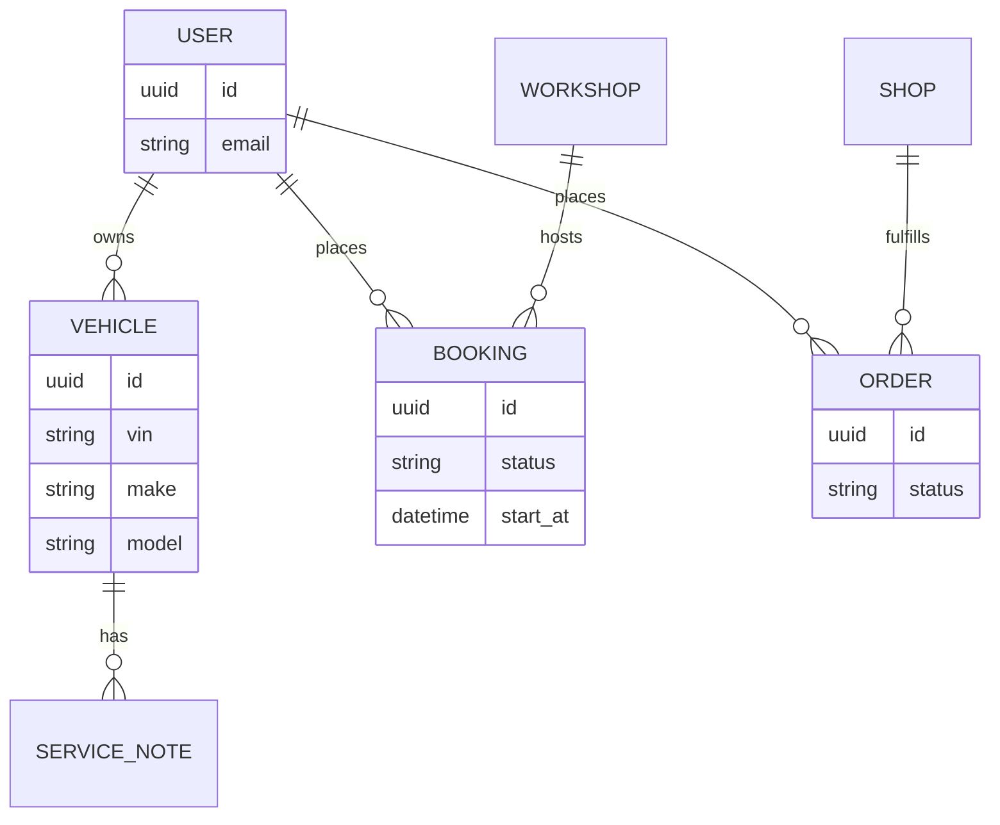

# Database Design

## Engine

**PostgreSQL 16** is the primary relational store for durable platform state.

## Conceptual Domains

Public documentation lists **domains**, not production schemas with real customer rows.

| Domain | Examples of entities (conceptual) |
|---|---|
| Identity | users, sessions, roles |
| Commerce / Parts | shops, offers references, carts, orders/leads |
| Service | workshops, bookings, posts, clients, service notes |
| Garage (App) | user vehicles, VIN-linked attributes |
| Marketing / AI | plans, audit entries for agent actions |
| Platform | products, entitlements / subscriptions |

## Design Notes

- Prefer normalized relational modeling for bookings, users, and shop configuration.
- Supplier catalog rows are often **ephemeral search results** (API-sourced) rather than a full mirrored SKU warehouse.
- Redis is **not** the system of record; it caches and brokers jobs.

## Example Schema Fragments (demo only)

See `examples/schemas/` for illustrative Pydantic / JSON Schema models. They are intentionally simplified and contain **no real user data**.

