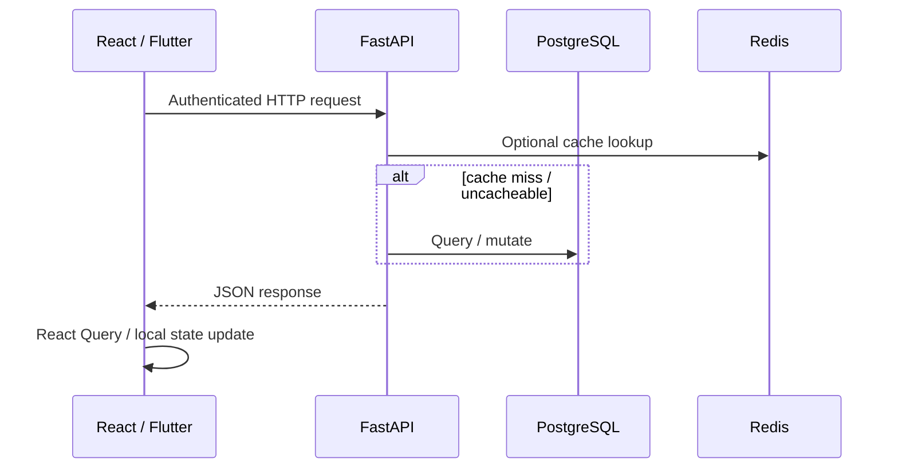

# Frontend Architecture

## Web

| Concern | Choice |
|---|---|
| UI library | React |
| Language | TypeScript |
| Build | Vite |
| Server state | React Query (TanStack Query) |

### Surfaces

- **Consumer / storefront UIs** for parts discovery
- **Store cabinet** — retailer operations (requests, orders, suppliers, pricing, profile, delivery, reviews, analytics, staff, subscription, settings — navigation defined by config)
- **Service cabinet** — workshop operations (clients, booking posts, related modules)
- **Platform owner cabinet** — cross-store / infrastructure-oriented views

Cabinets are treated as product applications with structured navigation, not a single undifferentiated admin theme.

## Mobile

See [mobile-app.md](mobile-app.md). Stack: **Flutter (Dart)**.

## Frontend ↔ Backend

## UX Engineering Notes

- Hash/route-driven cabinet sections for deep links
- Filter-first screens for requests/orders (status as filters, not separate top-level apps)
- Mobile screens map to garage, VIN/catalog, parts, orders, map/list services, booking, notes, notifications

## What This Repo Does Not Include

Private React/Flutter source trees are not published. Screenshots in `assets/screenshots/` should use test data only.
