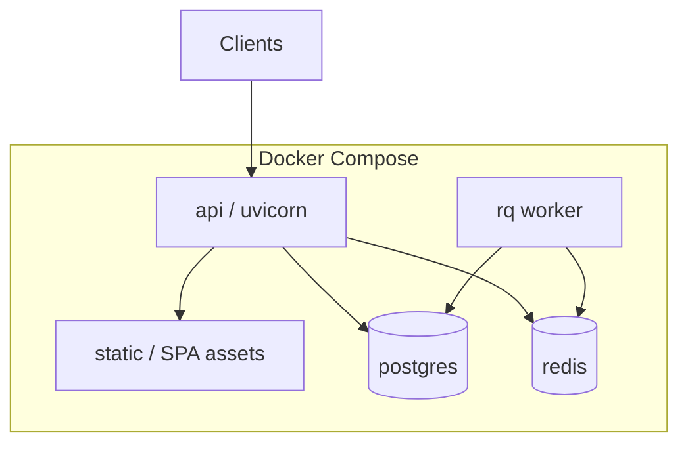

# Infrastructure

## Confirmed Shape

- **Docker Compose** packages application services (API, workers, Postgres, Redis, and related containers as used in private deploy)
- Hosted on a **VPS** under operator control
- Redis used for caching and job queues
- PostgreSQL for durable data

## Logical Compose Services (generic)

## What Is Omitted Publicly

- Real hostnames, IP addresses, SSH ports/users
- Compose override files with secrets
- Panel credentials and TLS private keys
- Exact process lists or monitoring vendor accounts

## Operational Concerns (described, not exposed)

- Binding sensitive admin surfaces appropriately
- Separating platform-owner views from tenant cabinets
- Disk and build-cache hygiene for mobile/CI artifacts (operational lesson from local APK builds)
- Dependency and image updates as part of ongoing maintenance

## Local Portfolio Note

This public repo does **not** ship a production Compose stack. Infrastructure docs exist for architectural clarity only.
