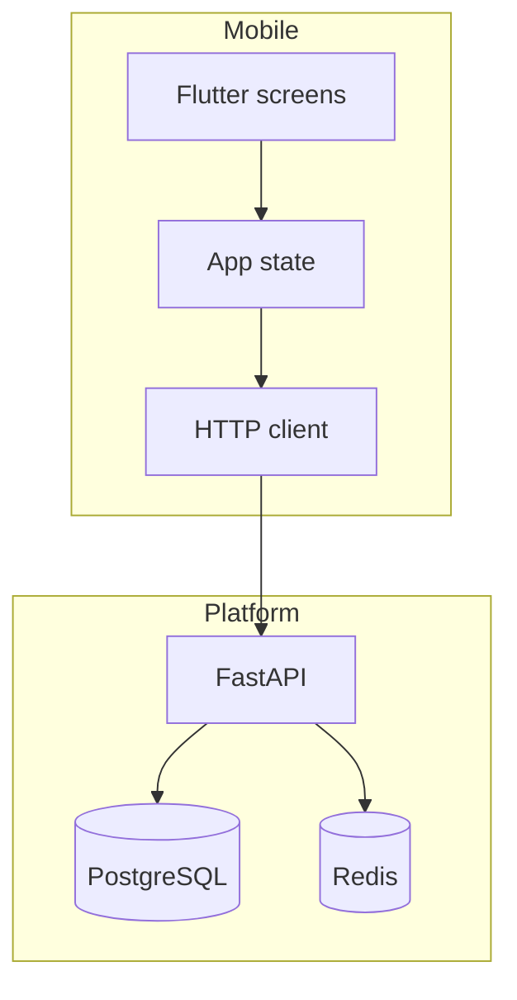
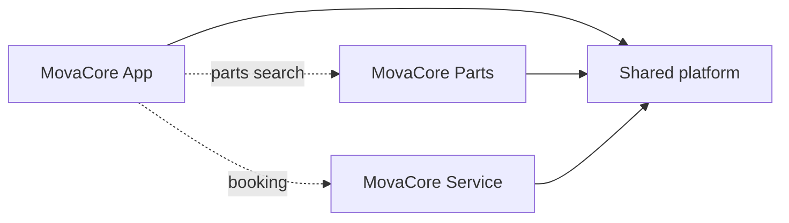
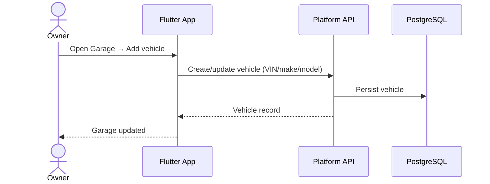
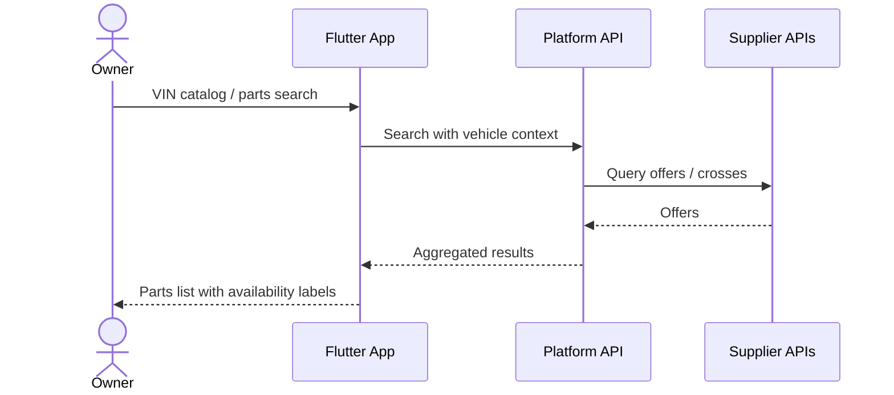
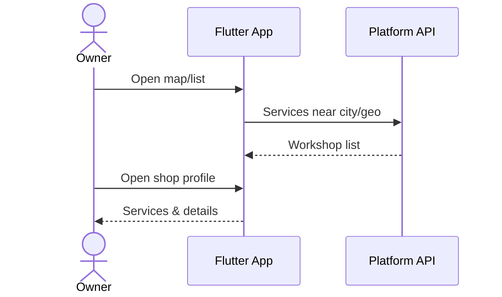
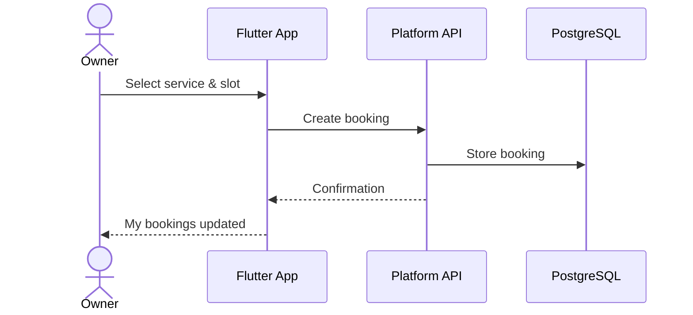
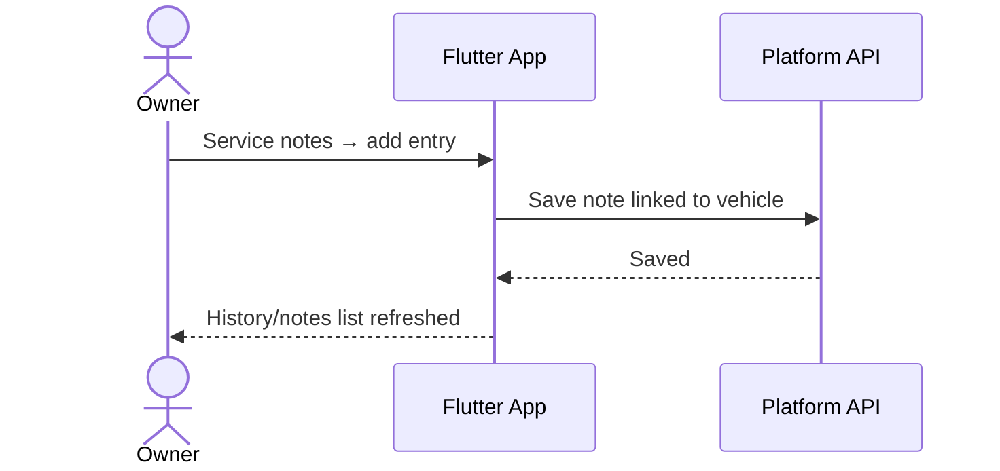
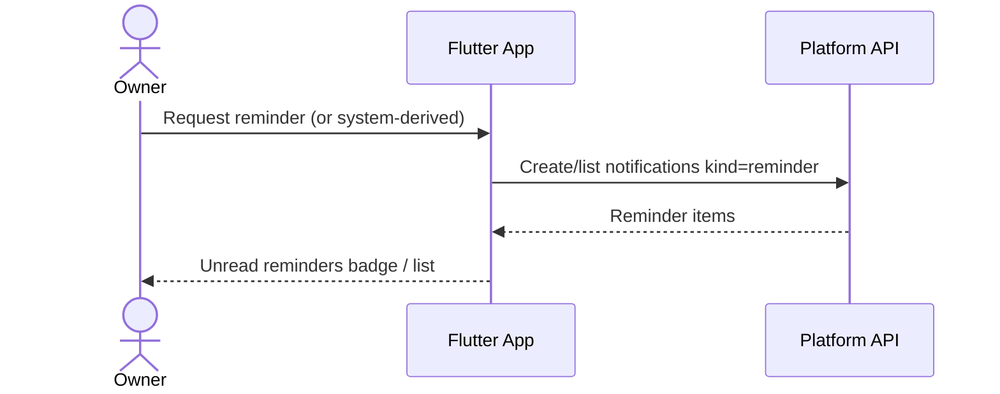

# MovaCore App — Automotive Companion

## Purpose

MovaCore App is the mobile surface of the MovaCore ecosystem. It helps vehicle owners manage cars, discover parts, find and book auto services, and keep maintenance-related notes — with the same platform backend that powers Parts and Service on the web.

## Audience

- Private vehicle owners who want one place for garage, parts, and service
- Users who already interact with MovaCore Parts / Service digitally

## Tech Stack (audit-confirmed)

| Layer | Technology |
|---|---|
| Framework | Flutter (Dart) |
| Backend | Shared FastAPI platform APIs |
| Local state | In-app state management talking to HTTP APIs |
| Auth | Login flow against platform APIs (session/token handled client-side securely; exact private scheme omitted) |

**Not claimed:** React Native, native-only Swift/Kotlin apps as the primary codebase.

## Product Directions & Status

Statuses are based on presence of screens/flows in the private Flutter project. “Implemented” means UI/API wiring exists in development; it does not assert production completeness for every edge case.

| Direction | Intent | Status |
|---|---|---|
| Garage | Manage user vehicles | **Implemented** (garage screens) |
| VIN Scanner / VIN catalog | Identify vehicle / catalog by VIN | **Implemented** (VIN catalog screen) |
| Parts Catalog | Search and browse spare parts | **Implemented** (parts screen + related flows) |
| My Orders | Cart / checkout / orders | **Implemented** (cart, checkout, orders screens) |
| Find Auto Service | Discover workshops (map/list) | **Implemented** (map, list, shop, services) |
| Service Booking | Book maintenance | **Implemented** (book + my bookings) |
| Appointments | Calendar of bookings | **Implemented partially** via bookings screens |
| Maintenance History | Long-term service history | **Partial** — service notes cover repair/service notes; full history productization evolving |
| Reminders | Maintenance reminders | **Partial** — reminder-kind notifications exist in app state; dedicated reminder product UX evolving |
| My Notes | Repair / service notes | **Implemented** (service notes screen) |
| In-app notifications | Notice center | **Implemented** (notifications screen + API polling style refresh) |
| Push notifications (FCM/APNs) | OS push delivery | **Not confirmed as production** in audit — do not claim |

## Main Screens (conceptual)

- Home / hub
- Garage
- VIN / catalog
- Parts + cart + checkout + orders
- Services map/list + shop detail
- Booking + my bookings
- Service notes
- Notifications
- Settings / city / login

## Architecture

### Backend interaction

- REST/JSON calls to platform routes for garage, parts search, cart, bookings, notifications
- Server remains source of truth; cart can sync to server when authenticated
- Errors and empty network states handled in UI flows (login redirect, empty garage prompts)

### Security (public description)

- Secrets for suppliers/LLM never embedded in the app
- Prefer authenticated API access for personal garage/orders/bookings
- Screenshots for portfolio must use test accounts only

## Ecosystem Links

## User Scenarios (Mermaid)

### 1. Add vehicle to garage

### 2. Search part by VIN

### 3. Find auto service

### 4. Book service

### 5. Add maintenance / service note

### 6. Create reminder

> Reminder UX is **partial**: notification kinds support reminders; treat dedicated scheduling productization as evolving.

## AI Opportunities (honest split)

| Idea | Status |
|---|---|
| Ads/marketing AI agent on platform | **Implemented** on web/marketing path (not the mobile chat UI) |
| In-app intelligent owner assistant | **Planned / idea** |
| Parts search from natural-language problem description | **Planned / idea** |
| Explain faults in plain language | **Planned / idea** |
| Maintenance recommendations | **Planned / idea** |
| Smart reminders | **Partial signals exist**; AI ranking not claimed |
| Agent over catalog + services | **Experimental future** |

Do not present mobile AI assistant features as shipped unless later audit confirms them.

## Development State

- Active Flutter codebase with substantial screen coverage for garage, parts, services, bookings, notes
- Continuously aligned with platform APIs
- Distribution (store listings, push, production signing) is outside this public repo

## Mobile Roadmap

- Harden booking + garage continuity
- Clarify reminders as a first-class feature
- Expand maintenance history beyond notes
- Evaluate Applied AI features only with validation and HITL where actions matter
- Add safe screenshots to `assets/screenshots/` for portfolio review
