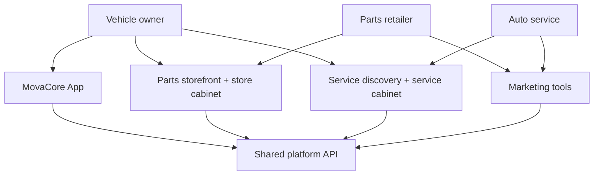

# Product Overview

## What MovaCore Is

MovaCore is an integrated digital ecosystem for the automotive industry. It combines:

1. **MovaCore Parts** — parts discovery and retailer cabinets  
2. **MovaCore Service** — service discovery, booking, and workshop cabinets  
3. **MovaCore Marketing** — growth tooling with Applied AI experiments for ads ops  
4. **MovaCore App** — Flutter companion for vehicle owners  

A shared Python/FastAPI backend, PostgreSQL, Redis, and worker processes support these surfaces.

## Ecosystem Model

## Design Principles (observed in the private system)

- **API-first sourcing** for parts availability (supplier integrations preferred over manual price-list uploads as the primary path)
- **Product-scoped cabinets** for operators (store vs service vs platform owner)
- **Shared mobile + web domain model** so garage, parts, and bookings can converge
- **AI with gates** — structured plans and allowlisted tools, with human confirmation before side effects

## Honest Scope of This Portfolio

This public repository describes architecture and demonstrates patterns. It does **not** claim completeness of every product idea listed in roadmaps, and it does not publish private metrics or customer data.

Further reading:

- [About the Builder](about-the-builder.md)
- [Engineering Case Studies](case-studies.md)
- [Engineering Decisions](engineering-decisions.md)
